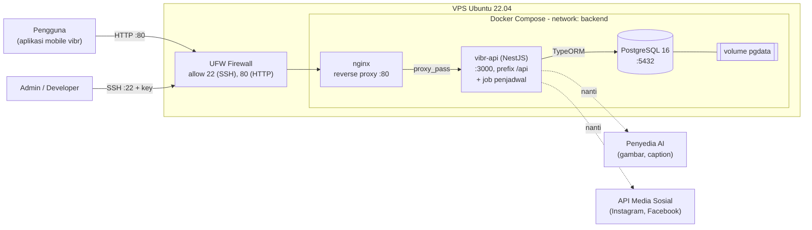

# Desain Arsitektur Sistem vibr

vibr adalah aplikasi mobile pembuat konten AI dan penjadwal posting media sosial. Backend-nya (`vibr-api`)
berjalan di VPS Ubuntu (VM lokal) memakai Docker Compose.

## Diagram

Garis putus-putus adalah integrasi yang saat ini masih placeholder (`MockAiProvider`, `MockPlatformPublisher`).

## Komponen

| Komponen | Teknologi | Peran |
|---|---|---|
| Klien | Aplikasi mobile vibr | Mengirim request REST ke `/api/...` dengan header `Authorization: Bearer <JWT>` |
| Firewall | UFW | Hanya membuka port 22 (SSH) dan 80 (HTTP); port lain ditutup |
| Reverse proxy | nginx (container) | Satu-satunya pintu masuk dari luar; meneruskan request ke API |
| Backend API | NestJS + TypeORM (container) | Auth JWT, brand, library media, AI job, jadwal posting, insight, komentar, notifikasi, dashboard, dan job penjadwal |
| Database | PostgreSQL 16 (container) | Menyimpan seluruh data; hanya bisa diakses dari network Docker dan localhost VPS |
| Penyimpanan | Docker volume `pgdata` | Data database tetap ada walau container dihapus/dibuat ulang |
| Akses admin | SSH (key ed25519), user `sysadmin` | Mengelola server tanpa password |
| Virtual environment | Python `venv` di `capstone-project/` | Lingkungan Python terisolasi untuk skrip pendukung di VPS |

## Alur request

1. Aplikasi mobile mengirim `POST /api/auth/login` ke IP VPS port 80.
2. UFW mengizinkan koneksi, nginx menerima, lalu meneruskan ke `api:3000`.
3. NestJS memvalidasi input (DTO), memeriksa JWT (guard), menjalankan logika modul terkait.
4. API membaca/menulis ke PostgreSQL lewat TypeORM di network `backend`.
5. Response dibungkus format standar `{ success, statusCode, message, data }` dan dikembalikan ke klien.

## Alur penjadwalan post

`PostSchedulesSchedulerService` berjalan di dalam container API. Tiap 30 detik ia mengambil `post_schedules`
berstatus `scheduled` yang waktunya sudah lewat (`UPDATE ... FOR UPDATE SKIP LOCKED`), mem-publish ke akun
sosialnya, lalu mencatat hasilnya di `published_posts` dan mengirim notifikasi ke pemilik brand.

## Keamanan

- Hanya nginx yang dipublikasikan ke luar. Container API tidak punya port publik.
- Port PostgreSQL hanya di-bind ke `127.0.0.1` VPS, tidak terbuka ke jaringan.
- Login SSH memakai key; firewall UFW membatasi port masuk.
- Rahasia (`DB_PASSWORD`, `JWT_SECRET`) disimpan di file `.env` yang tidak ikut ke Git/image.

## Rencana pengembangan

Migration TypeORM menggantikan `synchronize`, HTTPS (Let's Encrypt) di nginx, penyimpanan media (S3/Cloudinary),
integrasi penyedia AI dan API media sosial yang nyata.
