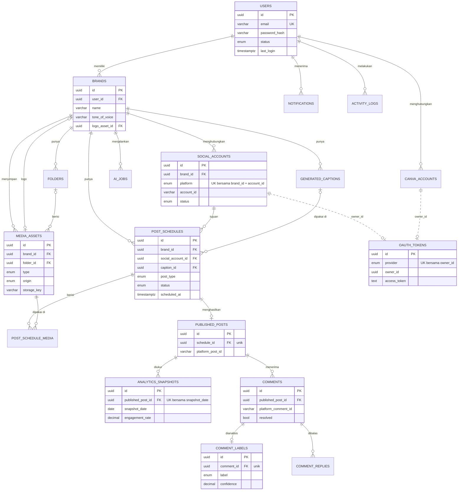

# Struktur Database vibr

PostgreSQL, dikelola lewat TypeORM. Skema dibuat otomatis dari entity saat `NODE_ENV=development`
(`synchronize: true`). Untuk production gunakan migration.

## Prinsip

- **Normalisasi sampai 3NF.** Data turunan tidak disimpan ganda (mis. brand dan platform sebuah komentar
  didapat lewat `published_posts` → `post_schedules`, bukan disalin ke `comments`).
- **UUID sebagai primary key** di semua tabel.
- **Timestamp** `created_at` dan `updated_at` (`timestamptz`, disimpan UTC).
- **Soft delete** lewat `deleted_at` di semua tabel kecuali `activity_logs`. Log audit hanya ditambah,
  tidak pernah diubah atau dihapus, jadi tidak punya `updated_at` maupun `deleted_at`.
- **Audit field** `created_by` / `updated_by` (id user, tanpa foreign key agar jejak tetap ada walau akun
  dihapus) di tabel yang dikerjakan user: `brands`, `social_accounts`, `folders`, `media_assets`,
  `generated_captions`, `ai_jobs`, `post_schedules`, `comment_replies`.
- **Tidak ada file di PostgreSQL.** Yang disimpan hanya metadata dan `storage_key`. URL publik dibentuk di
  aplikasi dari `STORAGE_BASE_URL` + `storage_key`.
- **Unique index parsial** (`WHERE deleted_at IS NULL`) di semua unique bisnis, agar baris yang sudah
  di-soft-delete tidak menghalangi data baru yang sama.

## Daftar entitas (18)

| # | Tabel | Fungsi |
|---|---|---|
| 1 | `users` | akun pengguna |
| 2 | `brands` | informasi brand |
| 3 | `social_accounts` | akun media sosial yang terhubung ke brand |
| 4 | `canva_accounts` | akun Canva milik user |
| 5 | `media_assets` | semua file media (metadata) |
| 6 | `folders` | folder library media |
| 7 | `post_schedules` | jadwal posting (inti sistem) |
| 8 | `post_schedule_media` | media pada sebuah posting |
| 9 | `generated_captions` | caption (hasil AI atau manual) |
| 10 | `published_posts` | hasil publish yang sukses |
| 11 | `analytics_snapshots` | statistik posting per tanggal |
| 12 | `comments` | komentar dari platform |
| 13 | `comment_labels` | hasil analisis sentimen AI |
| 14 | `comment_replies` | balasan komentar |
| 15 | `ai_jobs` | riwayat proses AI |
| 16 | `oauth_tokens` | token OAuth (akun sosial dan Canva) |
| 17 | `notifications` | notifikasi untuk user |
| 18 | `activity_logs` | audit log |

## ERD



Garis putus-putus `owner_id` bukan foreign key: satu kolom menunjuk ke dua tabel (lihat bagian keputusan desain).

## Kardinalitas

| Relasi | Kardinalitas |
|---|---|
| User → Brand | 1 : N |
| User → Canva Account | 1 : N |
| Brand → Social Account | 1 : N |
| Brand → Folder | 1 : N |
| Folder → Media Asset | 1 : N (media boleh tanpa folder) |
| Brand → Media Asset | 1 : N |
| Brand → Generated Caption | 1 : N |
| Brand → AI Job | 1 : N |
| Brand → Post Schedule | 1 : N |
| Social Account → Post Schedule | 1 : N |
| Post Schedule ↔ Media Asset | N : N (lewat `post_schedule_media`) |
| Post Schedule → Published Post | 1 : 0..1 |
| Published Post → Analytics Snapshot | 1 : N |
| Published Post → Comment | 1 : N |
| Comment → Comment Label | 1 : 0..1 (belum ada sampai dianalisis) |
| Comment → Comment Reply | 1 : N |

## Detail tabel

Kolom bersama (`id`, `created_at`, `updated_at`, `deleted_at`) tidak diulang di bawah.
Kolom audit `created_by` / `updated_by` ditandai **(audit)**.

### users
| Kolom | Tipe | Catatan |
|---|---|---|
| name | varchar(100) | |
| email | varchar(255) | unik |
| password_hash | varchar(255) | `select: false` |
| avatar_url | text | nullable |
| status | enum | `active`, `suspended` |
| last_login | timestamptz | diisi saat login |
| reset_token_hash, reset_token_expires_at | | di luar daftar awal, dibutuhkan alur "Forgot password" (hanya hash token) |

### brands (audit)
`user_id` FK, `name`, `description`, `industry`, `tone_of_voice` (teks bebas), `primary_color`,
`secondary_color` (hex `#RRGGBB`), `logo_asset_id` FK → `media_assets` (SET NULL).

### social_accounts (audit)
`brand_id` FK, `platform` enum (`facebook`, `instagram`, `threads`; TikTok dan LinkedIn menyusul),
`account_name` (tampil di UI), `account_id` (ID di platform), `status` enum (`connected`, `expired`, `disconnected`).
Unik: `(brand_id, platform, account_id)`. Token **tidak** ada di tabel ini.

### canva_accounts
`user_id` FK, `canva_user_id`. Unik: `(user_id, canva_user_id)`. Token ada di `oauth_tokens`.

### oauth_tokens
`provider` enum (`facebook`, `instagram`, `threads`, `canva`), `owner_id`, `access_token`, `refresh_token`,
`expired_at`. Token `select: false`. Unik: `(provider, owner_id)`.

### folders (audit)
`brand_id` FK, `name`. Unik: `(brand_id, name)`.

### media_assets (audit)
`brand_id` FK, `folder_id` FK (SET NULL), `type` enum (`image`, `video`),
`origin` enum (`gallery`, `image_ai`, `canva`, `background_removal`), `storage_key`, `filename`, `mime_type`,
`size` (byte, bigint), `width`, `height`, `duration` (detik), `thumbnail` (storage key thumbnail).

### generated_captions (audit)
`brand_id` FK, `prompt`, `caption`, `hashtags` (`text[]`, tanpa `#`), `llm_model`.
Caption yang diketik manual juga disimpan di sini dengan `prompt` dan `llm_model` = null.

### post_schedules (audit)
`brand_id` FK, `social_account_id` FK, `caption_id` FK (SET NULL, boleh kosong), `title`,
`post_type` enum (`post`, `story`, `reel`),
`status` enum (`draft`, `scheduled`, `publishing`, `published`, `failed`), `scheduled_at`, `published_at`.
Index: `(brand_id, scheduled_at)` untuk kalender, `(status, scheduled_at)` untuk job penjadwal.

### post_schedule_media
`schedule_id` FK, `media_asset_id` FK, `sort_order`. Unik: `(schedule_id, media_asset_id)`.

### published_posts
`schedule_id` FK (unik, 1 : 0..1), `platform_post_id`, `platform_url`, `published_at`.

### analytics_snapshots
`published_post_id` FK, `snapshot_date`, `impressions`, `reach`, `engagement`, `likes`, `comments`, `shares`,
`saves`, `engagement_rate` (persen), `avg_reach_per_post`. Unik: `(published_post_id, snapshot_date)`.
Angkanya **kumulatif** sampai tanggal snapshot; total sebuah periode memakai snapshot terbaru tiap posting,
bukan dijumlahkan antar tanggal.

### comments
`published_post_id` FK, `platform_comment_id`, `author_name`, `message`, `commented_at`, `resolved`.
Unik: `(published_post_id, platform_comment_id)`.

### comment_labels
`comment_id` FK (unik, 1 : 1), `label` enum (`positive`, `negative`, `question`), `confidence` (0..1),
`model_name`.

### comment_replies (audit)
`comment_id` FK, `reply_text`, `platform_reply_id`, `replied_at`. `created_by` = penulis balasan.

### ai_jobs (audit)
`brand_id` FK, `job_type` enum (`generate_image`, `regenerate_image`, `remove_background`, `caption`, `sentiment`),
`model`, `status` enum (`pending`, `processing`, `completed`, `failed`), `input_json` (jsonb),
`output_json` (jsonb; berisi `mediaAssetId`, `captionId`, hasil sentimen, atau `error`).

### notifications
`user_id` FK, `title`, `message`, `read_at` (null = belum dibaca).

### activity_logs
`user_id` FK (SET NULL), `action`, `entity` (nama tabel), `entity_id`, `metadata` (jsonb), `created_at`.
Tanpa `updated_at` dan `deleted_at`.

## Keputusan desain

- **Satu `post_schedules` = satu akun sosial.** Tayang di Instagram dan Facebook sekaligus berarti dua baris.
  Status, waktu publish, dan hasilnya otomatis terpisah per platform.
- **Tidak ada jadwal berulang.** Skema sebelumnya punya tabel `schedules` (harian/mingguan/bulanan) yang
  hanya menyimpan pola dan tidak pernah membuat posting. Di skema ini "jadwal" selalu satu posting
  dengan satu waktu tayang.
- **Token OAuth hanya di `oauth_tokens`.** Query biasa ke `social_accounts` / `canva_accounts` tidak pernah
  menyentuh token. `owner_id` menunjuk `social_accounts.id` (provider facebook/instagram/threads) atau
  `canva_accounts.id` (provider canva). Karena targetnya dua tabel, tidak ada foreign key;
  `OauthTokensService` yang menjaga konsistensinya (token ikut di-soft-delete saat akun diputus).
- **Brand dan platform sebuah komentar tidak disalin.** Didapat lewat
  `comments → published_posts → post_schedules → brands / social_accounts`.
- **Prioritas komentar diturunkan, bukan disimpan.** "Perlu dibalas" = `resolved = false` dan label
  `negative` atau `question`.
- **Waktu disimpan UTC** (`timestamptz`). Zona waktu hanya dipakai saat menampilkan dan mengelompokkan
  tanggal (parameter `timezone`, default `Asia/Jakarta`); tidak disimpan per user.
- **Relasi opsional memakai `SET NULL`** (mis. folder dihapus, media tetap ada). Relasi wajib memakai `CASCADE`.
  Karena soft delete tidak memicu `ON DELETE`, aplikasi melakukannya sendiri di tempat yang perlu
  (mis. `FoldersService.remove` mengosongkan `folder_id` media di dalamnya).
- **Multi-tenant.** Semua data bermuara ke `brands.user_id`. Setiap query memeriksa kepemilikan, dan data
  milik user lain dijawab 404 (bukan 403) supaya ID-nya tidak bisa ditebak.
- **Mengganti daftar media sebuah posting** me-soft-delete baris `post_schedule_media` lama lalu menambah
  baris baru.

## Migrasi dari skema lama

Skema ini menggantikan 13 tabel sebelumnya (`posts`, `post_targets`, `post_metrics`, `schedules`,
`schedule_accounts`, `ai_generations`, `insight_snapshots`, dst). Tidak ada migrasi data. Karena development
memakai `synchronize`, hapus database lama supaya tabel lama tidak tertinggal:

```bash
docker compose down -v
npm run db:up
```
